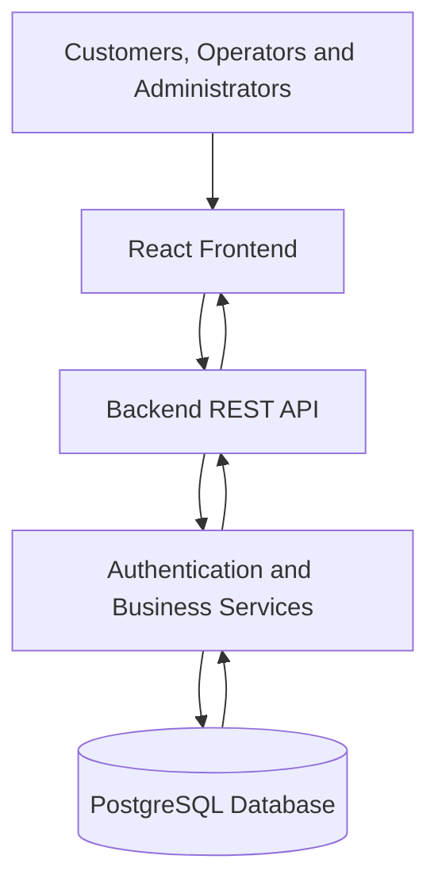

PARKLY — Intelligent Parking Slot Allocation

**PARKLY — Intelligent Parking Slot Allocation**

**Tagline:** Find your space. Move smarter.

**Repository:** https://github.com/dharanidhar-pro/DBMS_HACKATHON.git

I want the README to present the project as a serious, modern parking-management and intelligent reservation platform suitable for a professional portfolio, technical demonstration, project evaluation, and GitHub presentation.

## IMPORTANT INSTRUCTION

I want you to create the actual README content, not another prompt, outline, or set of instructions.

Inspect the existing repository, understand the implementation, and write the complete README directly into `README.md`.

Do not rebuild the application or unnecessarily modify application code. This task is primarily about documentation.

Do not invent implementation details, screenshots, test results, API endpoints, database tables, deployment links, or working integrations.

When a feature is not implemented, identify it honestly as planned, partially implemented, or not yet available.

---

# 1. PROJECT IDENTITY

Use these verified details:

- Project name: PARKLY
- Project title: Intelligent Parking Slot Allocation
- Tagline: Find your space. Move smarter.
- Team ID: 16
- Institution: KLH University
- Section: S8
- Course: Database Systems Engineering and Distributed Backend Development
- Academic year: 2026–2027
- Faculty guide: Dr. Prasanthi Y

## Team Members

| S. No. | Name | Student ID |
|---|---|---|
| 1 | Thrinadh | 2520030529 |
| 2 | Dharani Dhar | 2520030163 |
| 3 | Karthik | 2520030235 |
| 4 | Saisashank.b | 2520030454 |

Include the team information in a professional Contributors and Team section.

Do not invent team members' responsibilities, contact details, or social profiles.

---

# 2. PROFESSIONAL README DESIGN

Make the README visually attractive and easy to navigate on GitHub.

Use:

- A strong project title.
- A concise, memorable introduction.
- A professional table of contents.
- Clear section hierarchy.
- Well-formatted Markdown tables.
- Syntax-highlighted code blocks.
- Mermaid diagrams where appropriate.
- Relevant badges only when accurate.
- Consistent technical terminology.
- Concise explanations supported by useful detail.

Avoid:

- Excessive emoji.
- Walls of text.
- Repeated explanations.
- Generic filler.
- Fake badges.
- Broken images.
- Nonexistent links.
- Unsupported performance claims.
- Unverified deployment information.

Do not include a large number of empty screenshot placeholders.

If screenshots are not present, provide a concise section explaining where genuine screenshots can be added later.

---

# 3. REQUIRED README CONTENT

Create all the following sections, adapting their contents to the actual project.

## 3.1 Project Header

Include:

- PARKLY.
- Intelligent Parking Slot Allocation.
- Tagline.
- Short product description.
- Relevant repository links.
- Accurate technology badges where appropriate.

Use a concise opening paragraph explaining what the application does, who it serves, and why it is useful.

## 3.2 Table of Contents

Create links to all major sections so readers can navigate the README easily.

## 3.3 Project Overview

Explain PARKLY as a parking platform intended to help users discover parking facilities, find suitable slots, receive intelligent recommendations, and manage reservations.

Explain the roles of:

- Customers.
- Parking operators.
- Administrators.

Clarify the difference between features that currently work and features that remain planned.

## 3.4 Problem Statement

Discuss the challenges associated with conventional parking management:

- Difficulty finding available parking.
- Time wasted searching for suitable spaces.
- Vehicle and slot incompatibility.
- Reservation conflicts.
- Inefficient occupancy monitoring.
- Manual facility administration.
- Limited parking utilization insights.

Explain the need for a centralized, reliable, database-driven system.

## 3.5 Proposed Solution

Describe how PARKLY addresses the problem through:

- Centralized parking inventory.
- Facility and slot discovery.
- Vehicle-aware eligibility checks.
- Intelligent slot recommendations.
- Reservation management.
- Role-specific interfaces.
- Facility administration.
- Operational reporting.

Only claim that a capability is functional if supported by the code.

## 3.6 Project Objectives

Explain the major objectives:

1. Simplify parking discovery.
2. Recommend suitable parking slots.
3. Reduce conflicting reservations.
4. Maintain consistent reservation records.
5. Support customer vehicle management.
6. Improve facility operations.
7. Enforce secure role-based access.
8. Provide meaningful utilization reports.
9. Create a responsive, user-friendly interface.
10. Maintain a scalable and maintainable architecture.

## 3.7 Key Features

Create a feature table with columns such as:

| Feature | Description | Status |
|---|---|---|

Inspect the code and accurately assess:

- Customer registration.
- Customer authentication.
- Operator authentication.
- Administrator authentication.
- Role-based authorization.
- Parking facility discovery.
- Vehicle registration and management.
- Interactive parking-slot visualization.
- Availability filtering.
- Intelligent allocation.
- Reservation creation.
- Reservation cancellation.
- Reservation history.
- Operator dashboards.
- Facility and slot management.
- Administrator dashboard.
- User management.
- Analytics and reporting.
- Notifications.
- Audit logs.
- Theme switching.
- Responsive layouts.

Use clear statuses such as Implemented, Partially Implemented, Planned, or Not Available.

Do not mark a feature as implemented simply because a page or button exists.

## 3.8 User Roles and Permissions

Document the intended role model:

### Customer

- Register and sign in.
- Manage personal vehicles.
- Discover parking facilities.
- Request eligible slot recommendations.
- Create and manage reservations.
- View reservation history.

### Parking Operator

- Sign in to the operator workspace.
- Manage authorized facilities.
- Monitor slot occupancy.
- Manage slot availability.
- Review facility reservations.
- Access relevant operational reports.

### Administrator

- Access authorized platform administration.
- Manage users and roles.
- Manage facilities and parking inventory.
- Review reservations.
- Inspect analytics and audit logs.
- Configure supported system settings.

Make it clear that these are intended permissions and identify any functionality that is not yet implemented.

Explain that administrator and operator accounts must not be created through unrestricted public registration.

## 3.9 System Architecture

Inspect the actual repository and document its architecture.

Where supported by the implementation, explain:

- Frontend presentation layer.
- Backend API layer.
- Authentication and authorization.
- Business logic and allocation service.
- Database persistence.
- Testing and deployment components.

Include a Mermaid architecture diagram reflecting the actual implementation.

For example, if appropriate:

Adjust the diagram to match the actual code. Do not present an illustrative architecture as a verified implementation if the components differ.

## 3.10 Technology Stack

Inspect package manifests, configuration files, imports, and dependency files.

Document the actual:

- Frontend framework.
- Programming languages.
- Styling framework.
- Routing library.
- UI component libraries.
- Backend framework.
- API technology.
- Database.
- ORM.
- Migration system.
- Authentication libraries.
- Testing frameworks.
- Development tools.
- Containerization tools.

Possible technologies include React, TypeScript, Vite, Tailwind CSS, FastAPI, Python, SQLAlchemy, PostgreSQL, Alembic, Pytest, Vitest, Docker, and GitHub Actions.

Include only technologies actually used or clearly label proposed technologies as planned.

## 3.11 Intelligent Parking Slot Allocation

Explain the allocation algorithm in a technically accurate way.

Document the actual implementation of:

1. Validating the parking request.
2. Identifying the facility and vehicle.
3. Retrieving candidate slots.
4. Filtering incompatible slots.
5. Checking availability for the requested interval.
6. Excluding maintenance slots.
7. Applying accessibility and charging requirements.
8. Ranking eligible candidates.
9. Selecting the best candidate.
10. Rechecking availability during reservation creation.
11. Persisting the reservation.
12. Returning an explanation of the selection.

Explain the distinction between hard constraints and optional ranking preferences.

If a weighted scoring algorithm exists, document its actual formula and weights.

Do not invent scoring weights, optimization results, or performance improvements.

If the allocation algorithm is still planned, explain the intended approach and label it clearly as planned.

## 3.12 Reservation Lifecycle

Document the reservation workflow and actual supported statuses.

Potential statuses include:

- Pending.
- Confirmed.
- Active.
- Completed.
- Cancelled.
- Expired.
- No-show.

Only list statuses implemented by the application as existing functionality.

Explain:

- Reservation creation.
- Eligibility checks.
- Availability validation.
- Cancellation rules.
- Reservation history.
- Status transitions.
- Ownership checks.
- Prevention of overlapping reservations.

Include a Mermaid state diagram if the lifecycle is implemented and the diagram matches the code.

## 3.13 Database Design

Inspect the database models, schema, and migrations.

Document the actual entities and their responsibilities.

Potential entities include:

- Users.
- Roles.
- Vehicles.
- Parking facilities.
- Parking zones.
- Parking slots.
- Reservations.
- Allocation history.
- Notifications.
- Audit logs.

Do not list nonexistent tables as implemented.

Include an entity relationship diagram using Mermaid.

Explain actual relationships, primary keys, foreign keys, uniqueness constraints, indexes, and important data-integrity rules.

If the database is not fully implemented, document the current state and proposed schema separately.

## 3.14 API Documentation

Inspect actual API routers and endpoints.

Document:

- API base path.
- HTTP method.
- Endpoint.
- Purpose.
- Authentication requirements.
- Authorized roles where applicable.
- Relevant request or response information.

Organize endpoints into:

- Authentication.
- Users.
- Vehicles.
- Facilities.
- Parking slots.
- Allocation.
- Reservations.
- Analytics.
- Administration.

Link to the actual OpenAPI or Swagger documentation endpoint if available.

Do not invent endpoint paths or claim that nonexistent endpoints are operational.

## 3.15 Authentication and Security

Explain the actual implementation of:

- Password hashing.
- Authentication.
- Token or session management.
- Role-based authorization.
- Protected frontend routes.
- Backend permission checks.
- Reservation ownership.
- Environment-based secrets.
- Input validation.
- Error handling.
- Reservation-conflict prevention.

Clearly distinguish implemented controls from recommended future improvements.

Never include passwords, access tokens, private keys, or real production secrets.

## 3.16 Project Directory Structure

Inspect the repository and generate a directory tree that matches its actual structure.

Include the important frontend, backend, database, documentation, and test files.

Do not create a fictional directory structure merely to make the project look complete.

## 3.17 Installation and Local Setup

Provide accurate, reproducible setup instructions.

Include:

1. Prerequisites.
2. Cloning the repository.
3. Installing frontend dependencies.
4. Setting up the Python environment if applicable.
5. Installing backend dependencies.
6. Creating and configuring environment variables.
7. Setting up the database.
8. Running database migrations.
9. Seeding development data if supported.
10. Starting the backend.
11. Starting the frontend.
12. Opening the application in a browser.

Use the actual package scripts, file names, and directory paths from the repository.

Do not invent commands.

If Docker is supported, include Docker setup as a separate option.

## 3.18 Environment Variables

Document the environment variables required by the actual application.

Explain the purpose of each variable.

Reference `.env.example` if present.

If it is missing and appropriate to create, provide placeholder values only.

Never commit actual secrets.

Do not publish privileged demo passwords in the public README.

## 3.19 Development Demo Accounts

Explain how development demo accounts can be provisioned for:

- Customer.
- Operator.
- Administrator.

Inspect the existing seed scripts and account-creation mechanisms.

Provide actual commands where available.

If demo-account provisioning is missing, identify it as a limitation and recommend a safe development-only seed process.

Do not claim accounts exist or work unless they have been created and tested.

## 3.20 Testing and Quality Assurance

Document the actual testing frameworks and available commands.

Cover, where supported:

- Authentication tests.
- Role-based authorization tests.
- Parking allocation tests.
- Reservation conflict tests.
- Vehicle compatibility tests.
- API tests.
- Frontend component tests.
- End-to-end tests.
- Production build checks.

Report results only if the tests were executed.

Do not invent test coverage percentages or successful test runs.

## 3.21 User Interface and Screenshots

Describe the implemented user interface, including:

- Landing page.
- Customer login and registration.
- Customer dashboard.
- Parking discovery.
- Slot visualization.
- Reservation flow.
- Operator dashboard.
- Administrator dashboard.
- Theme system.

Reference genuine screenshots if they exist in the repository.

If screenshots do not exist, include instructions for adding them later without creating broken image references.

Keep screenshots and public documentation free of passwords, tokens, and sensitive information.

## 3.22 Deployment

Document the deployment approach supported by the repository.

If Docker, cloud hosting, CI/CD, or production configuration exists, explain how it works.

If the application has not been deployed, state that clearly.

Do not invent production URLs, hosting providers, deployment badges, or availability claims.

## 3.23 Error Handling and Troubleshooting

Include useful solutions for common development problems:

- Missing dependencies.
- Incorrect Node.js or Python versions.
- Port conflicts.
- Database connection failures.
- Missing environment variables.
- Migration failures.
- Invalid credentials.
- Authentication or authorization errors.
- CORS configuration.
- Frontend-to-backend connectivity.
- Docker startup issues, if applicable.

Make the troubleshooting advice consistent with the actual implementation.

## 3.24 Limitations

Document known limitations honestly.

Examples, only when applicable:

- Missing external map integration.
- No configured payment gateway.
- No real-time occupancy updates.
- Email or SMS notifications not configured.
- Incomplete analytics.
- Limited production deployment configuration.

Do not list a feature as missing if it is implemented.

## 3.25 Future Enhancements

Describe realistic potential improvements, clearly distinguishing them from existing functionality.

Potential enhancements include:

- Real-time occupancy updates.
- Map-based parking discovery.
- Navigation assistance.
- Payment-provider integration.
- Email and SMS notifications.
- Advanced allocation optimization.
- Predictive parking demand.
- Additional analytics.
- Accessibility improvements.
- Expanded automated testing.

## 3.26 Team Information

Include the verified institution, course, academic year, section, faculty guide, team ID, and four team members provided in this task.

Do not invent individual contributions.

## 3.27 License

Inspect the repository for a license.

If one exists, reference it accurately.

If no license exists, state that no license has been specified. Do not invent a license.

## 3.28 Acknowledgments

Add a concise acknowledgment recognizing the faculty guide and collaborative team effort.

Do not invent external sponsors, affiliations, partnerships, or endorsements.

---

# 4. FINAL QUALITY CHECK

Before finishing:

- Verify every technical statement against the repository.
- Verify that installation commands match the real project.
- Check internal Markdown links.
- Check Mermaid syntax.
- Ensure referenced files exist.
- Remove fake badges and broken image links.
- Separate existing features from planned enhancements.
- Confirm that team details match the supplied information.
- Do not expose secrets or privileged credentials.
- Keep the public PARKLY website free of academic and institutional details.
- Ensure the README is professional, complete, and easy to understand.

Write the finished content directly to the repository's `README.md`.

Do not respond with another prompt or just a summary of what should be included.

At the end, briefly report that the README was updated and list any important documentation gaps that could not be verified or resolved.
